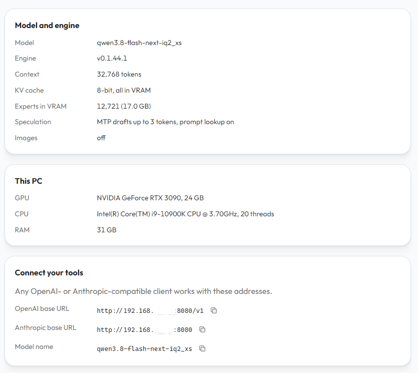
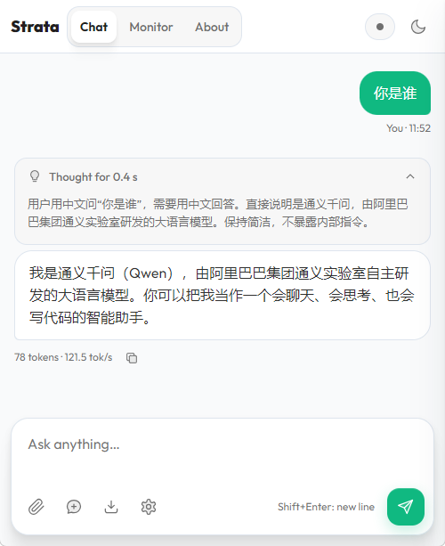
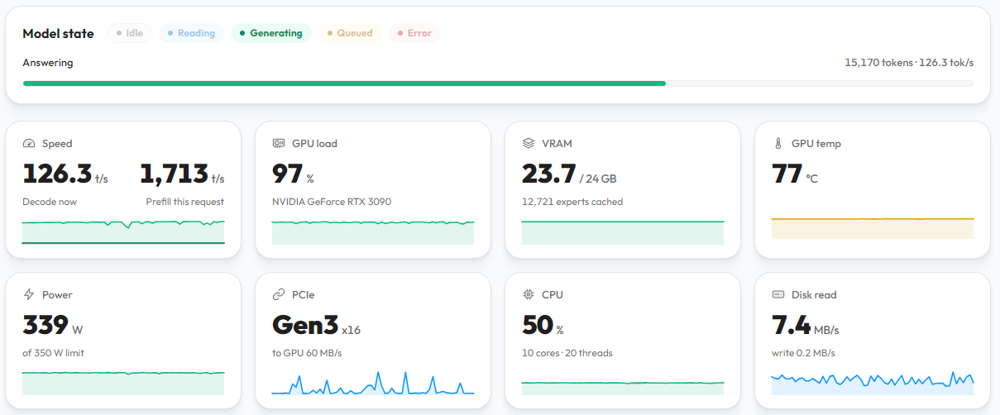
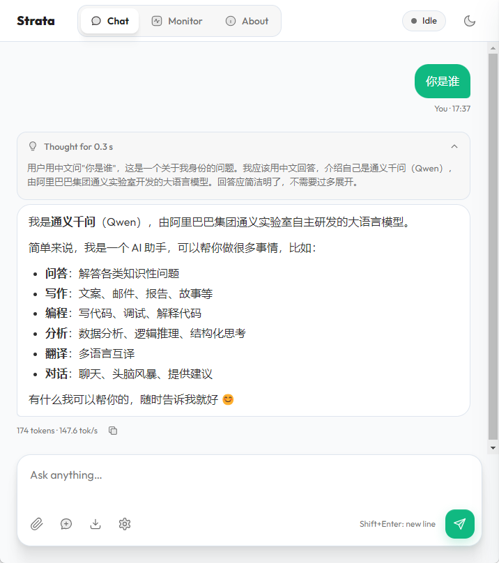

# 使用Strata部署180B大模型Qwen3.8-Flash-Next

# 前言
这年头不蹬一两下大模型都不好意思说自己是现代人了  
但是云端大模型有各种各样的不便之处，拒答率太高，还是得本地部署一个玩  
最近有一个叫strata的项目，跑单流还蛮好用的

只要有一张显存大于等于12的Volta架构以上N卡，再堆个24G以上的内存，就具备可用性

# 克隆项目仓库
选一个目录，直接执行命令就能clone下来
```shell
git clone https://github.com/Niko1221/Strata
```
大概回显是这样的，如果clone不下来也可以用`https://axisnow.gh-proxy.org/ `之类的镜像站
```text
root@fnos:/usr/games# git clone https://github.com/Niko1221/Strata
Cloning into 'Strata'...
remote: Enumerating objects: 20742, done.
remote: Total 20742 (delta 0), reused 0 (delta 0), pack-reused 20742 (from 1)
Receiving objects: 100% (20742/20742), 29.49 MiB | 547.00 KiB/s, done.
Resolving deltas: 100% (13878/13878), done.

```

# 构建容器
如果直接在宿主机跑，环境没有隔离可能会出事情  
而且Strata目前主要支持Ubuntu发行版，为了避免环境问题还是选择用docker跑  
直接如下构建容器即可，如果apt源之类的拉不下来，可以在dockerfile自己加一下sed命令替换镜像源  
不会的可以问问deepseek，这种问题它还是愿意回答你的  

不想构建也可以等我构建完了丢dockerhub

自己构建在项目目录下运行命令就行  
```shell
docker build -t strata .
```

<details>
<summary>点击展开容器构建</summary>

```text
root@fnos:/usr/games# cd Strata/
root@fnos:/usr/games/Strata# docker build -t makedie/strata .
[+] Building 1378.8s (14/14) FINISHED                                                                                                                              docker:default
 => [internal] load build definition from Dockerfile                                                                                                                         0.0s
 => => transferring dockerfile: 5.99kB                                                                                                                                       0.0s
 => resolve image config for docker-image://docker.io/docker/dockerfile:1                                                                                                    3.4s
 => docker-image://docker.io/docker/dockerfile:1@sha256:4edf897a3ffa55b89f906fc8cc78afdb3f1834cc9c7083565e611a8a7d5fe99e                                                     0.9s
 => => resolve docker.io/docker/dockerfile:1@sha256:4edf897a3ffa55b89f906fc8cc78afdb3f1834cc9c7083565e611a8a7d5fe99e                                                         0.0s
 => => sha256:4edf897a3ffa55b89f906fc8cc78afdb3f1834cc9c7083565e611a8a7d5fe99e 9.08kB / 9.08kB                                                                               0.0s
 => => sha256:7b32114e84ca21aeb2d6f871a0b62b3a0762193f75d9afd048ee4cbe889f3148 1.13kB / 1.13kB                                                                               0.0s
 => => sha256:528c92d70d7e39dbb3dd1c6681f6750c565c7e45b70527cda47c1a61495c1b6a 1.41kB / 1.41kB                                                                               0.0s
 => => sha256:9d2b4f57f9e20f33279375ce25c6ff14f30f64270ed5c7b613b2b30256754f62 14.28MB / 14.28MB                                                                             0.8s
 => => extracting sha256:9d2b4f57f9e20f33279375ce25c6ff14f30f64270ed5c7b613b2b30256754f62                                                                                    0.1s
 => [internal] load metadata for docker.io/nvidia/cuda:13.0.0-devel-ubuntu24.04                                                                                              3.1s
 => [internal] load .dockerignore                                                                                                                                            0.0s
 => => transferring context: 509B                                                                                                                                            0.0s
 => [1/7] FROM docker.io/nvidia/cuda:13.0.0-devel-ubuntu24.04@sha256:1e8ac7a54c184a1af8ef2167f28fa98281892a835c981ebcddb1fad04bdd452d                                      131.5s
 => => resolve docker.io/nvidia/cuda:13.0.0-devel-ubuntu24.04@sha256:1e8ac7a54c184a1af8ef2167f28fa98281892a835c981ebcddb1fad04bdd452d                                        0.0s
 => => sha256:435220c0fef35cbf712e11999f8670a83835ef3cdd18564e5e8122f83078c88c 2.63kB / 2.63kB                                                                               0.0s
 => => sha256:949aeb228afe6b802c1dbddad76439bc158a86f5900223ab13b3f60536b005a0 20.23kB / 20.23kB                                                                             0.0s
 => => sha256:32f112e3802cadcab3543160f4d2aa607b3cc1c62140d57b4f5441384f40e927 29.72MB / 29.72MB                                                                             1.7s
 => => sha256:9c9b39ad83d512d5af47e9c22f4458cb586f05ea478656a372c5e739cb7280e5 4.55MB / 4.55MB                                                                               0.5s
 => => sha256:0acb0bb33f9956b78fbfc026a81d9f3fbcf52f6c3c51ed7ff503b2f5db52d651 105.07MB / 105.07MB                                                                           5.5s
 => => sha256:1e8ac7a54c184a1af8ef2167f28fa98281892a835c981ebcddb1fad04bdd452d 743B / 743B                                                                                   0.0s
 => => sha256:ddc61996788ff6833bbe82138d6fc5000e848953b90df5055cbae21479218914 186B / 186B                                                                                   0.6s
 => => sha256:13e8f87efde86df96bfe73da211eb196d0416702b69d92947ec617138e6db64b 6.88kB / 6.88kB                                                                               0.7s
 => => sha256:1ba07b1309cf3cbf6f4649e357d9a21e94039b6100973ef20599eb4a11a8b338 1.51GB / 1.51GB                                                                              74.8s
 => => extracting sha256:32f112e3802cadcab3543160f4d2aa607b3cc1c62140d57b4f5441384f40e927                                                                                    0.5s
 => => sha256:84fef9f1ca4f21e9c7411db3c57fe91a1f401d7051d87a3bfed97ff70a2cf72c 59.61kB / 59.61kB                                                                             1.8s
 => => sha256:492db7b3e492442f7a1ad30fea534f61ad89da451c675ccab2488e41034d0886 1.68kB / 1.68kB                                                                               2.0s
 => => sha256:932162d4fcf6e1094ee1544e8fde0ae2a02b2c4e9545f64f373ce3a4479189e6 1.52kB / 1.52kB                                                                               2.0s
 => => sha256:04c1659590951cf4645f7fc21adeeb72ce204df3349b1b68e615ed5911f543d6 2.31GB / 2.31GB                                                                             116.6s
 => => extracting sha256:9c9b39ad83d512d5af47e9c22f4458cb586f05ea478656a372c5e739cb7280e5                                                                                    0.1s
 => => extracting sha256:0acb0bb33f9956b78fbfc026a81d9f3fbcf52f6c3c51ed7ff503b2f5db52d651                                                                                    0.9s
 => => sha256:5065c92eaa27f9fa100247b99dc946350ed4f7f2b4c5bf56da89df21462b7c4a 89.73kB / 89.73kB                                                                             5.7s
 => => extracting sha256:ddc61996788ff6833bbe82138d6fc5000e848953b90df5055cbae21479218914                                                                                    0.0s
 => => extracting sha256:13e8f87efde86df96bfe73da211eb196d0416702b69d92947ec617138e6db64b                                                                                    0.0s
 => => extracting sha256:1ba07b1309cf3cbf6f4649e357d9a21e94039b6100973ef20599eb4a11a8b338                                                                                    6.1s
 => => extracting sha256:84fef9f1ca4f21e9c7411db3c57fe91a1f401d7051d87a3bfed97ff70a2cf72c                                                                                    0.0s
 => => extracting sha256:492db7b3e492442f7a1ad30fea534f61ad89da451c675ccab2488e41034d0886                                                                                    0.0s
 => => extracting sha256:932162d4fcf6e1094ee1544e8fde0ae2a02b2c4e9545f64f373ce3a4479189e6                                                                                    0.0s
 => => extracting sha256:04c1659590951cf4645f7fc21adeeb72ce204df3349b1b68e615ed5911f543d6                                                                                   14.6s
 => => extracting sha256:5065c92eaa27f9fa100247b99dc946350ed4f7f2b4c5bf56da89df21462b7c4a                                                                                    0.0s
 => [internal] load build context                                                                                                                                            0.3s
 => => transferring context: 51.63MB                                                                                                                                         0.3s
 => [2/7] RUN apt-get update && apt-get install -y --no-install-recommends         build-essential ca-certificates curl git libatomic1 libgomp1         python3 python3-pi  28.2s
 => [3/7] WORKDIR /opt/strata                                                                                                                                                0.0s 
 => [4/7] COPY . .                                                                                                                                                           0.4s 
 => [5/7] RUN python3 -m venv .venv     && .venv/bin/pip install --no-cache-dir --upgrade pip     && .venv/bin/pip install --no-cache-dir -r requirements.txt     && chmod  20.3s 
 => [6/7] RUN .venv/bin/python - <<'PYEOF'                                                                                                                                1184.1s 
 => [7/7] RUN rm -rf build build-vision                                                                                                                                      0.4s 
 => exporting to image                                                                                                                                                       6.3s 
 => => exporting layers                                                                                                                                                      6.3s 
 => => writing image sha256:ff49a67935f4c4416536f39783daf275501cc465525b35ff3969a6f8d7ba50d5                                                                                 0.0s 
 => => naming to docker.io/makedie/strata:latest
```

</details>

# 准备好需要的模型
虽然strata可以自己下载模型，但都本地部署了肯定是想部署优化过的Qwen3.8-Flash-Next跑一些线上跑不了的东西  
下载模型文件如下形式放置即可。本例是`IQ2_XS`如果是其他量化级别需自行调整命令与文件名。
```text
root@fnos:/vol1/docker/strata_data# tree
.
├── models
│   └── IQ2_XS
│       ├── Qwen3.8-Flash-Next-GSQ-RCO-IQ2_XS-00001-of-00002.gguf
│       └── Qwen3.8-Flash-Next-GSQ-RCO-IQ2_XS-00002-of-00002.gguf
└── mtp
    └── rt
        ├── dense.bin
        ├── dense.txt
        ├── draft_vocab.bin
        └── experts.bin

5 directories, 8 files
```

# 运行strata

`MODEL`可选`Q2_0|IQ2_XS|IQ3_XXS|IQ3_S`  
实际上我感觉`IQ2_XS`就够了，反正也不是拿去写代码之类的  
甚至实测下来`IQ3_S`甚至`IQ2_XS`都比某些`官方api`提供的模型智商要高不少  
`KV`可选`int8|q4_0|k8v4`  
`CONTEXT`是上下文长度，可以自行调整，显存够大一口气拉到`262144`甚至更高也行  
如需要交错上下文，需要自行增加`--conversation-cache-mib 8192 --conversation-cache-slots 4`之类的参数调整缓存

需要注意由于显存常驻，此时其他任务，如影视相册等可能运行异常  
需要同时使用可以调整预留显存量供其他任务使用

以下例子使用的是IQ2_XS量化，int8的KV，32768的上下文  
根据需要可以自己调整各项参数
```shell
docker run --rm --gpus all -p 8080:8080 --ulimit memlock=-1 -v /vol1/docker/strata_data:/data -e MODEL=IQ2_XS -e FAMILY=qwen -e CONTEXT=32768 -e VISION=no -e REINSTALL=1 makedie/strata
```
执行后回显如下  
```text
root@fnos:/usr/games/Strata# docker run --rm --gpus all -p 8080:8080 --ulimit memlock=-1 -v /vol1/docker/strata_data:/data -e MODEL=IQ2_XS -e FAMILY=qwen -e CONTEXT=32768 -e VISION=no -e REINSTALL=1 makedie/strata
Setting up iq2_xs: downloading the model (~70 GB; the engine is already in the image).
Strata - Qwen3.8-Flash-Next on a normal PC (a GPU + system RAM + CPU)

=== Step 1: checking your PC ===
  [ok] GPU: NVIDIA GeForce RTX 3090, 24.0 GB VRAM, compute capability 8.6, driver 580.142
  [ok] RAM: 31 GB
  [ok] CPU: Intel(R) Core(TM) i9-10900K CPU @ 3.70GHz (AVX2)
  [ok] PCIe: 3.0 x16 (the card supports 4.0, the board 3.0)

=== Step 2: your choices ===
  [ok] model: Qwen3.8-Flash-Next

  1) Q2_0     2-bit, the fastest; download 66 GB, uses ~34 GB of RAM   <- fits in the low-RAM mode (the GPU holds ~56%, the rest in RAM)
  2) IQ2_XS   2-bit i-quant, a little better quality, close in speed; download 68 GB, uses ~36 GB of RAM   <- fits in the low-RAM mode (the GPU holds ~54%, the rest in RAM)
  3) IQ3_XXS  3-bit i-quant, better quality, slower (more CPU work per token); download 76 GB, uses ~43 GB of RAM   <- fits in the low-RAM mode (the GPU holds ~44%, the rest from the SSD)
  4) IQ3_S    (recommended) 3.5-bit i-quant, the best quality (matches the full model), the slowest; needs a 64 GB PC with little else running; download 84 GB, uses ~50 GB of RAM   <- needs 62 GB RAM, you have 31
  [ok] size: IQ2_XS
  [ok] context: 32768 tokens
  [ok] KV cache: 8-bit
  [ok] images: off
  [ok] low-RAM mode: the GPU holds ~54% of IQ2_XS's experts (36 GB) and the other ~16 GB stay in RAM (31 GB), read once from a copy in the model folder

  EXPERIMENTAL - speed projection: a small control vector applied while the model runs (layers 4-44).
  It changes how the model answers: its package describes it as a refusal-direction projection (the
  model declines far fewer requests). Off unless you choose it; when on, the web app can switch it off
  per chat. Details: data/experimental-speed-projection/README.md
  [ok] experimental speed projection: off

=== Step 3: Python packages ===
  Installing numpy, jinja2, regex, pyyaml, tqdm, requests, cmake, ninja, pillow, psutil ...
  > /opt/strata/.venv/bin/python -m pip install --quiet --disable-pip-version-check numpy==2.5.3; python_version >= "3.12" numpy==2.4.6; python_version == "3.11" numpy==2.2.6; python_version < "3.11" jinja2==3.1.6 regex==2026.9.10 pyyaml==6.0.3 tqdm==4.70.1 requests==2.34.2 cmake==4.4.3 ninja==1.13.2 pillow==12.3.0 psutil==7.2.2 markupsafe==3.0.3 certifi==2026.7.22 charset-normalizer==3.5.1 idna==3.20 urllib3==2.8.0 colorama==0.4.6; sys_platform == "win32"
  [ok] numpy, jinja2, regex, pyyaml, tqdm, requests, cmake, ninja, pillow, psutil installed

=== Step 4: the Strata engine ===
  [ok] llama.cpp 3cf0325 (gguf-py, ggml, mtmd)
  [ok] engine already built for this PC
  [ok] engine: /opt/strata/engine/strata

=== Step 5: downloading Qwen3.8-Flash-Next IQ2_XS ===
  [ok] Qwen3.8-Flash-Next-GSQ-RCO-IQ2_XS-00001-of-00002.gguf already downloaded
  [ok] Qwen3.8-Flash-Next-GSQ-RCO-IQ2_XS-00002-of-00002.gguf already downloaded
  [ok] model files present

=== Step 6: preparing the model for Strata ===
  > /opt/strata/.venv/bin/python /opt/strata/tools/iq_pack.py --gguf /data/models/IQ2_XS/Qwen3.8-Flash-Next-GSQ-RCO-IQ2_XS-00001-of-00002.gguf --out /data/packs/iq2_xs
model shards: Qwen3.8-Flash-Next-GSQ-RCO-IQ2_XS-00001-of-00002.gguf, Qwen3.8-Flash-Next-GSQ-RCO-IQ2_XS-00002-of-00002.gguf
index.txt: 1079 tensors, 302 served natively, 0 in extra.bin, arena 1.43 GiB
tokenizer/: vocab 248320, merges 247587, pre qwen35, specials {'tokenizer.ggml.eos_token_id': 248046, 'tokenizer.ggml.padding_token_id': 248044, 'tokenizer.ggml.bos_token_id': 248044}
  Writing the experts into one file for the low-RAM mode (one time, 36 GB) ...
  > /opt/strata/.venv/bin/python /opt/strata/tools/iq_pack.py --gguf /data/models/IQ2_XS/Qwen3.8-Flash-Next-GSQ-RCO-IQ2_XS-00001-of-00002.gguf --out /data/packs/iq2_xs --experts-bin
model shards: Qwen3.8-Flash-Next-GSQ-RCO-IQ2_XS-00001-of-00002.gguf, Qwen3.8-Flash-Next-GSQ-RCO-IQ2_XS-00002-of-00002.gguf
index.txt: 1079 tensors, 302 served natively, 0 in extra.bin, arena 1.43 GiB
  layer  0  IQ2_S   /Q2_0    blob  1510400  at 0.00 GiB
  layer  8  IQ1_M   /Q2_0    blob  1177600  at 5.57 GiB
  layer 16  IQ2_S   /Q2_0    blob  1510400  at 10.62 GiB
  layer 24  IQ2_S   /Q2_0    blob  1510400  at 16.19 GiB
  layer 32  IQ2_S   /Q2_0    blob  1510400  at 21.66 GiB
  layer 40  IQ2_S   /Q2_0    blob  1510400  at 27.26 GiB
experts.bin: 48 layers, 33.02 GiB
  [ok] model prepared: /data/packs/iq2_xs
  [ok] MTP draft layer: /data/mtp/rt

=== Step 7: writing the start script ===
  tip: this card drives a display. If the PC freezes or the screen goes black once the model is loaded (#779), keep more VRAM free: run setup again with --vram-reserve-mib 1500
  tip: on a PC with 31 GB of RAM, "env": {"STRATA_RESIDENT_HEADROOM_GIB": "6"} in the config kept decode speed in a community benchmark and left the system 2 GiB more (#834); the default is 4
  [ok] start script: run-iq2_xs.sh

All set.
  API (OpenAI):     http://127.0.0.1:8080/v1   (any API key; model name: anything)
  API (Anthropic):  http://127.0.0.1:8080/v1/messages
  Other devices:    the server window prints this PC's address (http://<IP>:8080/) - no API key set: anyone on your network can use it
  Next time:        just run ./setup.sh (or run-iq2_xs.sh) - it starts right away
  Several requests at once (opt-in): --parallel 2 decodes up to 2 together instead of one after the other (each takes ~0.6 GB of VRAM from the expert cache; docs/BATCHING.md).
Config: /data/config/strata-iq2_xs.json (from MODEL IQ2_XS, just set up)
Strata - Qwen3.8-Flash-Next on a normal PC (a GPU + system RAM + CPU)
  [ok] GPU: GPU 0 (NVIDIA GeForce RTX 3090, 24 GB)

  ----------------------------------------------------------------------------------------------------
  Starting qwen3.8-flash-next-iq2_xs: it loads about 40 GB into RAM and locks part of it for the GPU.
  While it does, YOUR PC CAN BE SLOW OR STOP RESPONDING FOR 1-3 MINUTES (longer the first time after a
  restart). That is normal: please wait and don't close this window - the browser opens when it is ready.
  Later, closing this window stops the model.
  ----------------------------------------------------------------------------------------------------
  Settings (strata-iq2_xs.json): --expert-cache auto --prefill auto --spec 4 --spec-min-p 0.5
    --max-context 32768 --kv int8 --resident-experts; server 0.0.0.0:8080, gpu 0
loading the model (the first start takes a minute or two) ...
[strata] starting the engine: reading the model's weights ...
[strata] loading the experts the GPU does not hold into RAM (of about 40 GB) and locking part of them for the GPU.
         YOUR PC CAN BE SLOW OR STOP RESPONDING FOR 1-3 MINUTES NOW - this is normal.
         Please wait and don't close this window; the browser opens when it is ready.
[strata] filling the GPU's expert cache (12721 experts, 17.05 GiB of VRAM) ...
[strata] almost ready ...
ready: http://127.0.0.1:8080/v1  (OpenAI: /v1/chat/completions, Anthropic: /v1/messages, context 32768 tokens)
       open http://127.0.0.1:8080/ in a browser to chat; close this window to stop the model
       from other devices: http://172.17.0.2:8080/   (API: http://172.17.0.2:8080/v1)
       WARNING: no API key - anyone on your network can use this model. Add "api_key": "..." to the config (clients send it as their API key; the web page asks for it)
```

# 简单测试
使用浏览器打开`http://IP:8080/` 页面
## 观察配置
在这里可以观察到主要配置  

## 短长度
可以直接在页面问问它是谁  

## 中长度
可以使用agent进行调用测试，本步骤必须要执行  
最好压到上下文长度极限观察是否会崩溃  
如果会崩溃需要调整参数


# 调优运行
## 为什么要调优
默认情况下，虽然strata是可用状态，但实际上并没有以最优形式运行  
需要进行调优操作
## 进入strata环境
使用如下命令，创建容器但不使用默认入口
```shell
docker run --rm -it --gpus all -p 8080:8080 --ulimit memlock=-1 -v /vol1/docker/strata_data:/data -e MODEL=IQ2_XS -e FAMILY=qwen -e CONTEXT=262144 -e VISION=no --entrypoint "bash" makedie/strata:0.1.44.1
```
## 预链接Strata-data目录
在默认以容器运行时`/data`目录是数据存储目录，但如果直接运行则是`strata`目录上级的`Strata-data`目录  
因此需要预先把目录链接上
```text
root@a5a272c310cf:/opt/strata# ln -s /data /opt/Strata-data
```
## 自动化参数调优
每次修改配置后，建议都进行调优操作，以下是两个调优案例

<details>
<summary>点击展开调优1</summary>

```text
root@a5a272c310cf:/opt/strata# ./setup.sh 
Strata - Qwen3.8-Flash-Next on a normal PC (a GPU + system RAM + CPU)

=== Step 1: checking your PC ===
  [ok] GPU: NVIDIA GeForce RTX 3090, 24.0 GB VRAM, compute capability 8.6, driver 580.142
  [ok] RAM: 31 GB
  [ok] CPU: Intel(R) Core(TM) i9-10900K CPU @ 3.70GHz (AVX2)
  [ok] PCIe: 3.0 x16 (the card supports 4.0, the board 3.0)

=== Step 2: your choices ===
  1) Qwen3.8-Flash-Next   Qwen; GSQ-RCO quants by ISTA-DASLab - the original model
  2) Swift 1.5            UkisAI's fine-tune of Qwen3.8-Flash-Next - thinks much shorter (-63% thinking tokens, 1.8x sooner answers by its authors' numbers)
  3) Qwen3.8-Flash-Next Coder ISTA-DASLab's coding version - half the experts (code, tools, images kept): needs ~32 GB of RAM, faster; weaker outside coding
  4) Qwen3.8-Flash-Next (Unsloth) Unsloth's 4- to 8-bit quantizations - UD-IQ4_XS, UD-Q4_K_XL, UD-Q5_K_XL, UD-Q6_K_XL or Q8_0 (94 to 188 GB downloads): every expert in RAM from ~80 GB (UD-IQ4_XS) to ~136 GB (Q8_0) of RAM, else part of them read from the SSD
  5) Qwen3.8-Flash-Next (NVFP4) NVFP4 packs by sergqwer (strata-nvfp4) - 4-bit NVFP4 experts, NVIDIA cards; a 128 GB download, ~80 GB of RAM to keep every expert in RAM   [runs, but UD-IQ4_XS is faster on this card; 128 GB download, ~80 GB of RAM keeps every expert in RAM]
  6) Qwen3.6-35B-A3B      Qwen; GGUFs with the MTP layer by Unsloth - 35B mixture of experts with 3B active (256 experts, top-8): a smaller cousin of Qwen3.8-Flash-Next with the same tokenizer   [new]
Which model? [1]: 1
  [ok] model: Qwen3.8-Flash-Next

  1) Q2_0     2-bit, the fastest; download 66 GB, uses ~34 GB of RAM   <- fits in the low-RAM mode (the GPU holds ~56%, the rest in RAM)
  2) IQ2_XS   2-bit i-quant, a little better quality, close in speed; download 68 GB, uses ~36 GB of RAM   <- fits in the low-RAM mode (the GPU holds ~54%, the rest in RAM)
  3) IQ3_XXS  3-bit i-quant, better quality, slower (more CPU work per token); download 76 GB, uses ~43 GB of RAM   <- fits in the low-RAM mode (the GPU holds ~44%, the rest from the SSD)
  4) IQ3_S    (recommended) 3.5-bit i-quant, the best quality (matches the full model), the slowest; needs a 64 GB PC with little else running; download 84 GB, uses ~50 GB of RAM   <- needs 62 GB RAM, you have 31
Which size? [1]: 2
  [ok] size: IQ2_XS

  Context length = how much text the model can see at once (your chat, files, tool output).
  Longer needs more VRAM for it, so fewer experts fit on the GPU:
  1) 8K tokens
  2) 32K tokens
  3) 64K tokens
  4) 128K tokens   (recommended for your GPU)
  5) 200K tokens
  6) 256K tokens
  7) 384K tokens   (experimental: setup adds rope scaling)
  8) 512K tokens   (experimental: setup adds rope scaling)
Context? [4]: 2
  [ok] context: 32768 tokens

  KV cache precision (the model's memory of the conversation):
  1) 8-bit   (recommended: what every published number was measured with)
  2) 4-bit   half the memory (about 4% faster at 128K), but measurably less precise on long
             documents; long-context lookups (needle tests) still pass
KV cache? [1]: 2
  [ok] KV cache: 4-bit (Hadamard-rotated)

  Images: the model can also read pictures (screenshots, photos, scanned pages). This adds a 0.9 GB
  download and keeps ~1.4 GB of VRAM free for the image encoder, so text is a few % slower.
Do you want images? [n]: 
  [ok] images: off
  [ok] low-RAM mode: the GPU holds ~54% of IQ2_XS's experts (36 GB) and the other ~16 GB stay in RAM (31 GB), read once from a copy in the model folder

  EXPERIMENTAL - speed projection: a small control vector applied while the model runs (layers 4-44).
  It changes how the model answers: its package describes it as a refusal-direction projection (the
  model declines far fewer requests). Off unless you choose it; when on, the web app can switch it off
  per chat. Details: data/experimental-speed-projection/README.md
Turn on the experimental speed projection? [n]: 
  [ok] experimental speed projection: off

=== Step 3: Python packages ===
  [ok] numpy, jinja2, regex, pyyaml, tqdm, requests, cmake, ninja, pillow, psutil already installed

=== Step 4: the Strata engine ===
  [ok] llama.cpp 3cf0325 (gguf-py, ggml, mtmd)
  [ok] engine already built for this PC
  [ok] engine: /opt/strata/engine/strata

=== Step 5: downloading Qwen3.8-Flash-Next IQ2_XS ===
  [ok] Qwen3.8-Flash-Next-GSQ-RCO-IQ2_XS-00001-of-00002.gguf already downloaded
  [ok] Qwen3.8-Flash-Next-GSQ-RCO-IQ2_XS-00002-of-00002.gguf already downloaded
  [ok] model files present

=== Step 6: preparing the model for Strata ===
  [ok] model prepared: /opt/Strata-data/packs/iq2_xs
  [ok] MTP draft layer: /opt/Strata-data/mtp/rt

=== Step 7: writing the start script ===
  tip: this card drives a display. If the PC freezes or the screen goes black once the model is loaded (#779), keep more VRAM free: run setup again with --vram-reserve-mib 1500
  tip: on a PC with 31 GB of RAM, "env": {"STRATA_RESIDENT_HEADROOM_GIB": "6"} in the config kept decode speed in a community benchmark and left the system 2 GiB more (#834); the default is 4
Tune Strata for this PC now? It measures a few engine settings (about 15-30 minutes, longer on a slow card; the PC is busy meanwhile; later: START-HERE --calibrate) [y]: 

  Tuning Strata for this PC: the output speed is measured with a few engine settings (the PCIe share, the
  draft depth, the CPU threads, the expert cache). It takes roughly 15-30 minutes (3 rounds of each value); the PC is busy meanwhile.
  Loading the model for the measurements ...
[strata] starting the engine: reading the model's weights ...
[strata] loading the experts the GPU does not hold into RAM (of about 40 GB) and locking part of them for the GPU.
         YOUR PC CAN BE SLOW OR STOP RESPONDING FOR 1-3 MINUTES NOW - this is normal.
         Please wait and don't close this window; the browser opens when it is ready.
[strata] filling the GPU's expert cache (12861 experts, 17.24 GiB of VRAM) ...
[strata] almost ready ...
    round 1/3 PCIe share: 0 108.2  0.2 111.7  0.35 109.3  0.36 113.5  0.55 114.4  0.75 108.0  0.9 104.3  1 98.4
    round 2/3 PCIe share: 0 109.0  0.2 113.4  0.35 113.1  0.36 110.8  0.55 111.6  0.75 103.9  0.9 102.7  1 96.4
    round 3/3 PCIe share: 0 115.2  0.2 110.7  0.35 114.0  0.36 114.0  0.55 109.3  0.75 104.8  0.9 107.1  1 95.7
    PCIe share, median of 3: 0: 109.0 (108.2-115.2), 0.2: 111.7 (110.7-113.4), 0.35: 113.1 (109.3-114.0), 0.36: 113.5 (110.8-114.0), 0.55: 111.6 (109.3-114.4), 0.75: 104.8 (103.9-108.0), 0.9: 104.3 (102.7-107.1), 1: 96.4 (95.7-98.4) -> best 0.36
    round 1/3 draft floor: 0.3 113.4  0.5 113.4  0.7 113.8
    round 2/3 draft floor: 0.3 102.4  0.5 109.3  0.7 120.0
    round 3/3 draft floor: 0.3 111.0  0.5 110.8  0.7 112.7
    draft floor, median of 3: 0.3: 111.0 (102.4-113.4), 0.5: 110.8 (109.3-113.4), 0.7: 113.8 (112.7-120.0) -> best 0.7
  Measuring with 9 CPU workers (restarts the engine) ...
[strata] starting the engine: reading the model's weights ...
[strata] loading the experts the GPU does not hold into RAM (of about 40 GB) and locking part of them for the GPU.
         YOUR PC CAN BE SLOW OR STOP RESPONDING FOR 1-3 MINUTES NOW - this is normal.
         Please wait and don't close this window; the browser opens when it is ready.
[strata] filling the GPU's expert cache (12861 experts, 17.24 GiB of VRAM) ...
[strata] almost ready ...
    9 workers: 113.9 tok/s
  Measuring with 6 CPU workers (restarts the engine) ...
[strata] starting the engine: reading the model's weights ...
[strata] loading the experts the GPU does not hold into RAM (of about 40 GB) and locking part of them for the GPU.
         YOUR PC CAN BE SLOW OR STOP RESPONDING FOR 1-3 MINUTES NOW - this is normal.
         Please wait and don't close this window; the browser opens when it is ready.
[strata] filling the GPU's expert cache (12861 experts, 17.24 GiB of VRAM) ...
[strata] almost ready ...
    6 workers: 113.6 tok/s
  Measuring with 4 CPU workers (restarts the engine) ...
[strata] starting the engine: reading the model's weights ...
[strata] loading the experts the GPU does not hold into RAM (of about 40 GB) and locking part of them for the GPU.
         YOUR PC CAN BE SLOW OR STOP RESPONDING FOR 1-3 MINUTES NOW - this is normal.
         Please wait and don't close this window; the browser opens when it is ready.
[strata] filling the GPU's expert cache (12861 experts, 17.24 GiB of VRAM) ...
[strata] almost ready ...
    4 workers: 112.8 tok/s
  Measuring with 2 CPU workers (restarts the engine) ...
[strata] starting the engine: reading the model's weights ...
[strata] loading the experts the GPU does not hold into RAM (of about 40 GB) and locking part of them for the GPU.
         YOUR PC CAN BE SLOW OR STOP RESPONDING FOR 1-3 MINUTES NOW - this is normal.
         Please wait and don't close this window; the browser opens when it is ready.
[strata] filling the GPU's expert cache (12861 experts, 17.24 GiB of VRAM) ...
[strata] almost ready ...
    2 workers: 104.7 tok/s
  Measuring the expert tier (the engine default) (restarts the engine) ...
[strata] starting the engine: reading the model's weights ...
[strata] loading the experts the GPU does not hold into RAM (of about 40 GB) and locking part of them for the GPU.
         YOUR PC CAN BE SLOW OR STOP RESPONDING FOR 1-3 MINUTES NOW - this is normal.
         Please wait and don't close this window; the browser opens when it is ready.
[strata] filling the GPU's expert cache (12861 experts, 17.24 GiB of VRAM) ...
[strata] almost ready ...
    114.7 tok/s
  Measuring the expert tier every 1, 80 swaps, decay 0.97 (restarts the engine) ...
[strata] starting the engine: reading the model's weights ...
[strata] loading the experts the GPU does not hold into RAM (of about 40 GB) and locking part of them for the GPU.
         YOUR PC CAN BE SLOW OR STOP RESPONDING FOR 1-3 MINUTES NOW - this is normal.
         Please wait and don't close this window; the browser opens when it is ready.
[strata] filling the GPU's expert cache (12861 experts, 17.24 GiB of VRAM) ...
[strata] almost ready ...
    106.3 tok/s
  Measuring the expert tier every 1, 160 swaps, decay 0.97 (restarts the engine) ...
[strata] starting the engine: reading the model's weights ...
[strata] loading the experts the GPU does not hold into RAM (of about 40 GB) and locking part of them for the GPU.
         YOUR PC CAN BE SLOW OR STOP RESPONDING FOR 1-3 MINUTES NOW - this is normal.
         Please wait and don't close this window; the browser opens when it is ready.
[strata] filling the GPU's expert cache (12861 experts, 17.24 GiB of VRAM) ...
[strata] almost ready ...
    104.4 tok/s
  [ok] tuned for this PC: the default settings are already the fastest here (114.7 tok/s)
  [ok] start script: run-iq2_xs.sh

All set.
  API (OpenAI):     http://127.0.0.1:8080/v1   (any API key; model name: anything)
  API (Anthropic):  http://127.0.0.1:8080/v1/messages
  Next time:        just run ./setup.sh (or run-iq2_xs.sh) - it starts right away
  Several requests at once (opt-in): --parallel 3 decodes up to 3 together instead of one after the other (each takes ~0.4 GB of VRAM from the expert cache; docs/BATCHING.md).
Run a quick benchmark now? It measures this install for about 10 minutes and writes a report you can share (later: ./bench.sh) [n]: 
  [ok] GPU: GPU 0 (NVIDIA GeForce RTX 3090, 24 GB)

  ----------------------------------------------------------------------------------------------------
  Starting qwen3.8-flash-next-iq2_xs: it loads about 40 GB into RAM and locks part of it for the GPU.
  While it does, YOUR PC CAN BE SLOW OR STOP RESPONDING FOR 1-3 MINUTES (longer the first time after a
  restart). That is normal: please wait and don't close this window - the browser opens when it is ready.
  Later, closing this window stops the model.
  ----------------------------------------------------------------------------------------------------
  Settings (strata-iq2_xs.json): --expert-cache auto --prefill auto --spec 4 --max-context 32768 --kv
    q4_0 --resident-experts --spec-min-p 0.5; server 127.0.0.1:8080, gpu 0
loading the model (the first start takes a minute or two) ...
[strata] starting the engine: reading the model's weights ...
[strata] loading the experts the GPU does not hold into RAM (of about 40 GB) and locking part of them for the GPU.
         YOUR PC CAN BE SLOW OR STOP RESPONDING FOR 1-3 MINUTES NOW - this is normal.
         Please wait and don't close this window; the browser opens when it is ready.
[strata] filling the GPU's expert cache (12861 experts, 17.24 GiB of VRAM) ...
[strata] almost ready ...
ready: http://127.0.0.1:8080/v1  (OpenAI: /v1/chat/completions, Anthropic: /v1/messages, context 32768 tokens)
       open http://127.0.0.1:8080/ in a browser to chat; close this window to stop the model

```

</details>

<details>
<summary>点击展开调优2</summary>

```text
root@c894ba6db5d2:/opt/strata# ./setup.sh 
Strata - Qwen3.8-Flash-Next on a normal PC (a GPU + system RAM + CPU)

=== Step 1: checking your PC ===
  [ok] GPU: NVIDIA GeForce RTX 3090, 24.0 GB VRAM, compute capability 8.6, driver 580.142
  [ok] RAM: 31 GB
  [ok] CPU: Intel(R) Core(TM) i9-10900K CPU @ 3.70GHz (AVX2)
  [ok] PCIe: 3.0 x16 (the card supports 4.0, the board 3.0)

=== Step 2: your choices ===
  1) Qwen3.8-Flash-Next   Qwen; GSQ-RCO quants by ISTA-DASLab - the original model
  2) Swift 1.5            UkisAI's fine-tune of Qwen3.8-Flash-Next - thinks much shorter (-63% thinking tokens, 1.8x sooner answers by its authors' numbers)
  3) Qwen3.8-Flash-Next Coder ISTA-DASLab's coding version - half the experts (code, tools, images kept): needs ~32 GB of RAM, faster; weaker outside coding
  4) Qwen3.8-Flash-Next (Unsloth) Unsloth's 4- to 8-bit quantizations - UD-IQ4_XS, UD-Q4_K_XL, UD-Q5_K_XL, UD-Q6_K_XL or Q8_0 (94 to 188 GB downloads): every expert in RAM from ~80 GB (UD-IQ4_XS) to ~136 GB (Q8_0) of RAM, else part of them read from the SSD
  5) Qwen3.8-Flash-Next (NVFP4) NVFP4 packs by sergqwer (strata-nvfp4) - 4-bit NVFP4 experts, NVIDIA cards; a 128 GB download, ~80 GB of RAM to keep every expert in RAM   [runs, but UD-IQ4_XS is faster on this card; 128 GB download, ~80 GB of RAM keeps every expert in RAM]
  6) Qwen3.6-35B-A3B      Qwen; GGUFs with the MTP layer by Unsloth - 35B mixture of experts with 3B active (256 experts, top-8): a smaller cousin of Qwen3.8-Flash-Next with the same tokenizer   [new]
Which model? [1]: 1
  [ok] model: Qwen3.8-Flash-Next

  1) Q2_0     2-bit, the fastest; download 66 GB, uses ~34 GB of RAM   <- fits in the low-RAM mode (the GPU holds ~56%, the rest in RAM)
  2) IQ2_XS   2-bit i-quant, a little better quality, close in speed; download 68 GB, uses ~36 GB of RAM   <- fits in the low-RAM mode (the GPU holds ~54%, the rest in RAM)
  3) IQ3_XXS  3-bit i-quant, better quality, slower (more CPU work per token); download 76 GB, uses ~43 GB of RAM   <- fits in the low-RAM mode (the GPU holds ~44%, the rest from the SSD)
  4) IQ3_S    (recommended) 3.5-bit i-quant, the best quality (matches the full model), the slowest; needs a 64 GB PC with little else running; download 84 GB, uses ~50 GB of RAM   <- needs 62 GB RAM, you have 31
Which size? [1]: 2
  [ok] size: IQ2_XS

  Context length = how much text the model can see at once (your chat, files, tool output).
  Longer needs more VRAM for it, so fewer experts fit on the GPU:
  1) 8K tokens
  2) 32K tokens
  3) 64K tokens
  4) 128K tokens   (recommended for your GPU)
  5) 200K tokens
  6) 256K tokens
  7) 384K tokens   (experimental: setup adds rope scaling)
  8) 512K tokens   (experimental: setup adds rope scaling)
Context? [4]: 6
  [ok] context: 262144 tokens

  KV cache precision (the model's memory of the conversation):
  1) 8-bit   (recommended: what every published number was measured with)
  2) 4-bit   half the memory (about 4% faster at 128K), but measurably less precise on long
             documents; long-context lookups (needle tests) still pass
KV cache? [1]: 8^H
  please answer one of: 1, 2
KV cache? [1]: 
  [ok] KV cache: 8-bit

  Images: the model can also read pictures (screenshots, photos, scanned pages). This adds a 0.9 GB
  download and keeps ~1.4 GB of VRAM free for the image encoder, so text is a few % slower.
Do you want images? [n]: 
  [ok] images: off
  [ok] low-RAM mode: the GPU holds ~45% of IQ2_XS's experts (36 GB) and the other ~20 GB stay in RAM (31 GB), read once from a copy in the model folder

  EXPERIMENTAL - speed projection: a small control vector applied while the model runs (layers 4-44).
  It changes how the model answers: its package describes it as a refusal-direction projection (the
  model declines far fewer requests). Off unless you choose it; when on, the web app can switch it off
  per chat. Details: data/experimental-speed-projection/README.md
Turn on the experimental speed projection? [n]: 
  [ok] experimental speed projection: off

=== Step 3: Python packages ===
  Installing numpy, jinja2, regex, pyyaml, tqdm, requests, cmake, ninja, pillow, psutil ...
  > /opt/strata/.venv/bin/python -m pip install --quiet --disable-pip-version-check numpy==2.5.3; python_version >= "3.12" numpy==2.4.6; python_version == "3.11" numpy==2.2.6; python_version < "3.11" jinja2==3.1.6 regex==2026.9.10 pyyaml==6.0.3 tqdm==4.70.1 requests==2.34.2 cmake==4.4.3 ninja==1.13.2 pillow==12.3.0 psutil==7.2.2 markupsafe==3.0.3 certifi==2026.7.22 charset-normalizer==3.5.1 idna==3.20 urllib3==2.8.0 colorama==0.4.6; sys_platform == "win32"
  [ok] numpy, jinja2, regex, pyyaml, tqdm, requests, cmake, ninja, pillow, psutil installed

=== Step 4: the Strata engine ===
  [ok] llama.cpp 3cf0325 (gguf-py, ggml, mtmd)
  [ok] engine already built for this PC
  [ok] engine: /opt/strata/engine/strata

=== Step 5: downloading Qwen3.8-Flash-Next IQ2_XS ===
  [ok] Qwen3.8-Flash-Next-GSQ-RCO-IQ2_XS-00001-of-00002.gguf already downloaded
  [ok] Qwen3.8-Flash-Next-GSQ-RCO-IQ2_XS-00002-of-00002.gguf already downloaded
  [ok] model files present

=== Step 6: preparing the model for Strata ===
  [ok] model prepared: /opt/Strata-data/packs/iq2_xs
  [ok] MTP draft layer: /opt/Strata-data/mtp/rt

=== Step 7: writing the start script ===
  [ok] KV streaming off: it needs ~3.6 GB of RAM beside the ~48 GB IQ2_XS uses, and this PC has 31; the KV cache stays in VRAM (fewer cached experts). --kv-streaming on turns it on anyway
  tip: this card drives a display. If the PC freezes or the screen goes black once the model is loaded (#779), keep more VRAM free: run setup again with --vram-reserve-mib 1500
  tip: on a PC with 31 GB of RAM, "env": {"STRATA_RESIDENT_HEADROOM_GIB": "6"} in the config kept decode speed in a community benchmark and left the system 2 GiB more (#834); the default is 4
Tune Strata for this PC now? It measures a few engine settings (about 15-30 minutes, longer on a slow card; the PC is busy meanwhile; later: START-HERE --calibrate) [y]: 

  Tuning Strata for this PC: the output speed is measured with a few engine settings (the PCIe share, the
  draft depth, the CPU threads, the expert cache). It takes roughly 15-30 minutes (3 rounds of each value); the PC is busy meanwhile.
  Loading the model for the measurements ...
[strata] starting the engine: reading the model's weights ...
[strata] loading the experts the GPU does not hold into RAM (of about 40 GB) and locking part of them for the GPU.
         YOUR PC CAN BE SLOW OR STOP RESPONDING FOR 1-3 MINUTES NOW - this is normal.
         Please wait and don't close this window; the browser opens when it is ready.
[strata] filling the GPU's expert cache (10227 experts, 13.70 GiB of VRAM) ...
[strata] almost ready ...
    round 1/3 PCIe share: 0 100.2  0.2 108.3  0.35 108.1  0.36 105.4  0.55 97.7  0.75 89.9  0.9 86.8  1 82.7
    round 2/3 PCIe share: 0 105.5  0.2 108.2  0.35 103.8  0.36 105.7  0.55 97.4  0.75 88.0  0.9 84.3  1 77.2
    round 3/3 PCIe share: 0 105.0  0.2 103.5  0.35 106.5  0.36 97.9  0.55 98.2  0.75 90.1  0.9 84.9  1 74.0
    PCIe share, median of 3: 0: 105.0 (100.2-105.5), 0.2: 108.2 (103.5-108.3), 0.35: 106.5 (103.8-108.1), 0.36: 105.4 (97.9-105.7), 0.55: 97.7 (97.4-98.2), 0.75: 89.9 (88.0-90.1), 0.9: 84.9 (84.3-86.8), 1: 77.2 (74.0-82.7) -> best 0.2
    round 1/3 draft floor: 0.3 103.6  0.5 102.3  0.7 103.9
    round 2/3 draft floor: 0.3 103.3  0.5 95.5  0.7 105.2
    round 3/3 draft floor: 0.3 99.9  0.5 104.7  0.7 104.0
    draft floor, median of 3: 0.3: 103.3 (99.9-103.6), 0.5: 102.3 (95.5-104.7), 0.7: 104.0 (103.9-105.2) -> best 0.7
  Measuring with 9 CPU workers (restarts the engine) ...
[strata] starting the engine: reading the model's weights ...
[strata] loading the experts the GPU does not hold into RAM (of about 40 GB) and locking part of them for the GPU.
         YOUR PC CAN BE SLOW OR STOP RESPONDING FOR 1-3 MINUTES NOW - this is normal.
         Please wait and don't close this window; the browser opens when it is ready.
[strata] filling the GPU's expert cache (10227 experts, 13.70 GiB of VRAM) ...
[strata] almost ready ...
    9 workers: 104.2 tok/s
  Measuring with 6 CPU workers (restarts the engine) ...
[strata] starting the engine: reading the model's weights ...
[strata] loading the experts the GPU does not hold into RAM (of about 40 GB) and locking part of them for the GPU.
         YOUR PC CAN BE SLOW OR STOP RESPONDING FOR 1-3 MINUTES NOW - this is normal.
         Please wait and don't close this window; the browser opens when it is ready.
[strata] filling the GPU's expert cache (10227 experts, 13.70 GiB of VRAM) ...
[strata] almost ready ...
    6 workers: 103.7 tok/s
  Measuring with 4 CPU workers (restarts the engine) ...
[strata] starting the engine: reading the model's weights ...
[strata] loading the experts the GPU does not hold into RAM (of about 40 GB) and locking part of them for the GPU.
         YOUR PC CAN BE SLOW OR STOP RESPONDING FOR 1-3 MINUTES NOW - this is normal.
         Please wait and don't close this window; the browser opens when it is ready.
[strata] filling the GPU's expert cache (10227 experts, 13.70 GiB of VRAM) ...
[strata] almost ready ...
    4 workers: 99.3 tok/s
  Measuring with 2 CPU workers (restarts the engine) ...
[strata] starting the engine: reading the model's weights ...
[strata] loading the experts the GPU does not hold into RAM (of about 40 GB) and locking part of them for the GPU.
         YOUR PC CAN BE SLOW OR STOP RESPONDING FOR 1-3 MINUTES NOW - this is normal.
         Please wait and don't close this window; the browser opens when it is ready.
[strata] filling the GPU's expert cache (10227 experts, 13.70 GiB of VRAM) ...
[strata] almost ready ...
    2 workers: 84.7 tok/s
  Measuring the expert tier (the engine default) (restarts the engine) ...
[strata] starting the engine: reading the model's weights ...
[strata] loading the experts the GPU does not hold into RAM (of about 40 GB) and locking part of them for the GPU.
         YOUR PC CAN BE SLOW OR STOP RESPONDING FOR 1-3 MINUTES NOW - this is normal.
         Please wait and don't close this window; the browser opens when it is ready.
[strata] filling the GPU's expert cache (10227 experts, 13.70 GiB of VRAM) ...
[strata] almost ready ...
    102.6 tok/s
  Measuring the expert tier every 1, 80 swaps, decay 0.97 (restarts the engine) ...
[strata] starting the engine: reading the model's weights ...
[strata] loading the experts the GPU does not hold into RAM (of about 40 GB) and locking part of them for the GPU.
         YOUR PC CAN BE SLOW OR STOP RESPONDING FOR 1-3 MINUTES NOW - this is normal.
         Please wait and don't close this window; the browser opens when it is ready.
[strata] filling the GPU's expert cache (10227 experts, 13.70 GiB of VRAM) ...
[strata] almost ready ...
    94.9 tok/s
  Measuring the expert tier every 1, 160 swaps, decay 0.97 (restarts the engine) ...
[strata] starting the engine: reading the model's weights ...
[strata] loading the experts the GPU does not hold into RAM (of about 40 GB) and locking part of them for the GPU.
         YOUR PC CAN BE SLOW OR STOP RESPONDING FOR 1-3 MINUTES NOW - this is normal.
         Please wait and don't close this window; the browser opens when it is ready.
[strata] filling the GPU's expert cache (10227 experts, 13.70 GiB of VRAM) ...
[strata] almost ready ...
    97.1 tok/s
  [ok] tuned for this PC: --pcie-frac 0.20, --spec-min-p 0.70 (102.6 tok/s)
  [ok] start script: run-iq2_xs.sh

All set.
  API (OpenAI):     http://127.0.0.1:8080/v1   (any API key; model name: anything)
  API (Anthropic):  http://127.0.0.1:8080/v1/messages
  Next time:        just run ./setup.sh (or run-iq2_xs.sh) - it starts right away
  Several requests at once: left at one at a time - parallel N reduces waiting for several users but costs about 10-25% speed per request on this card (docs/BATCHING.md).
Run a quick benchmark now? It measures this install for about 10 minutes and writes a report you can share (later: ./bench.sh) [n]: 
  [ok] GPU: GPU 0 (NVIDIA GeForce RTX 3090, 24 GB)

  ----------------------------------------------------------------------------------------------------
  Starting qwen3.8-flash-next-iq2_xs: it loads about 40 GB into RAM and locks part of it for the GPU.
  While it does, YOUR PC CAN BE SLOW OR STOP RESPONDING FOR 1-3 MINUTES (longer the first time after a
  restart). That is normal: please wait and don't close this window - the browser opens when it is ready.
  Later, closing this window stops the model.
  ----------------------------------------------------------------------------------------------------
  Settings (strata-iq2_xs.json): --expert-cache auto --prefill auto --spec 4 --max-context 262144 --kv
    int8 --resident-experts --pcie-frac 0.20 --spec-min-p 0.70; server 127.0.0.1:8080, gpu 0
loading the model (the first start takes a minute or two) ...
[strata] starting the engine: reading the model's weights ...
[strata] loading the experts the GPU does not hold into RAM (of about 40 GB) and locking part of them for the GPU.
         YOUR PC CAN BE SLOW OR STOP RESPONDING FOR 1-3 MINUTES NOW - this is normal.
         Please wait and don't close this window; the browser opens when it is ready.
[strata] filling the GPU's expert cache (10227 experts, 13.70 GiB of VRAM) ...
[strata] almost ready ...
ready: http://127.0.0.1:8080/v1  (OpenAI: /v1/chat/completions, Anthropic: /v1/messages, context 262144 tokens)
       open http://127.0.0.1:8080/ in a browser to chat; close this window to stop the model

```

</details>

## 调优配置结果
自动调优完成后，可以直接观察使用
```text
root@a5a272c310cf:/opt/strata# cat strata-iq2_xs.json 
```

<details>
<summary>点击展开调优结果1</summary>

```json
{
 "exe": "/opt/strata/engine/strata",
 "args": [
  "--pack",
  "/opt/Strata-data/packs/iq2_xs",
  "--native",
  "/opt/Strata-data/models/IQ2_XS/Qwen3.8-Flash-Next-GSQ-RCO-IQ2_XS-00001-of-00002.gguf",
  "--ple-gguf",
  "/opt/Strata-data/models/IQ2_XS/Qwen3.8-Flash-Next-GSQ-RCO-IQ2_XS-00002-of-00002.gguf",
  "--expert-profile",
  "/opt/strata/data/expert-profile.bin",
  "--expert-cache",
  "auto",
  "--prefill",
  "auto",
  "--spec",
  "4",
  "--mtp",
  "/opt/Strata-data/mtp/rt",
  "--max-context",
  "32768",
  "--kv",
  "q4_0",
  "--resident-experts",
  "--spec-min-p",
  "0.5"
 ],
 "cwd": "/opt/strata",
 "tokenizer": "/opt/Strata-data/packs/iq2_xs/tokenizer",
 "model_name": "qwen3.8-flash-next-iq2_xs",
 "log": "/opt/strata/strata-iq2_xs.log",
 "lib_dirs": [
  "/usr/local/cuda/bin",
  "/usr/local/cuda/lib64"
 ],
 "port": 8080,
 "gpu": 0,
 "gpus_asked": true
}
```

</details>

<details>
<summary>点击展开调优结果2</summary>

```json
{
 "exe": "/opt/strata/engine/strata",
 "args": [
  "--pack",
  "/opt/Strata-data/packs/iq2_xs",
  "--native",
  "/opt/Strata-data/models/IQ2_XS/Qwen3.8-Flash-Next-GSQ-RCO-IQ2_XS-00001-of-00002.gguf",
  "--ple-gguf",
  "/opt/Strata-data/models/IQ2_XS/Qwen3.8-Flash-Next-GSQ-RCO-IQ2_XS-00002-of-00002.gguf",
  "--expert-profile",
  "/opt/strata/data/expert-profile.bin",
  "--expert-cache",
  "auto",
  "--prefill",
  "auto",
  "--spec",
  "4",
  "--mtp",
  "/opt/Strata-data/mtp/rt",
  "--max-context",
  "262144",
  "--kv",
  "int8",
  "--resident-experts",
  "--pcie-frac",
  "0.20",
  "--spec-min-p",
  "0.70"
 ],
 "cwd": "/opt/strata",
 "tokenizer": "/opt/Strata-data/packs/iq2_xs/tokenizer",
 "model_name": "qwen3.8-flash-next-iq2_xs",
 "log": "/opt/strata/strata-iq2_xs.log",
 "lib_dirs": [
  "/usr/local/cuda/bin",
  "/usr/local/cuda/lib64"
 ],
 "port": 8080,
 "gpu": 0,
 "gpus_asked": true
}
```

</details>

<details>
<summary>点击展开调优结果3</summary>

```json

{
"exe": "/opt/strata/engine/strata",
"args": [
"--pack",
"/data/packs/swift-iq3_s",
"--native",
"/data/models/swift-IQ3_S/Swift-Qwen3.8-Flash-Next-GSQ-RCO-IQ3_S-00001-of-00002.gguf",
"--ple-gguf",
"/data/models/swift-IQ3_S/Swift-Qwen3.8-Flash-Next-GSQ-RCO-IQ3_S-00001-of-00002.gguf",
"--expert-profile",
"/opt/strata/data/expert-profile.bin",
"--expert-cache",
"auto",
"--prefill",
"auto",
"--spec",
"4",
"--mtp",
"/data/mtp/rt",
"--max-context",
"262144",
"--kv",
"int8",
"--mmap-experts",
"--pcie-frac",
"0.20",
"--spec-min-p",
"0.70",
"--conversation-cache-mib",
"4096",
"--conversation-cache-slots",
"4",
"--kv-grow"
],
"cwd": "/opt/strata",
"tokenizer": "/data/packs/swift-iq3_s/tokenizer",
"model_name": "swift-1.5-iq3_s",
"log": "/opt/strata/strata-swift-iq3_s.log",
"lib_dirs": [
"/usr/local/cuda/bin",
"/usr/local/cuda/lib64"
],
"port": 8080,
"gpu": 0,
"gpus_asked": true,
"host": "0.0.0.0"
}

```

</details>

## 验证调优结果
提升如图所示，提升了多少可以回头看看上面那个默认运行的  


# 结束语
这么好用的东西，怎么没有人打个包丢应用中心呢？